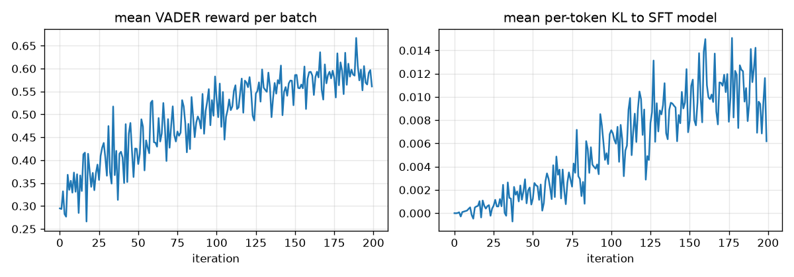

# minimal-rlhf

Implementation of the core RLHF loop on TinyStories dataset:

1. **Pretrain** a tiny character-level GPT (4 layers, 128-dim, 0.8M params) on TinyStories.
2. **SFT** on the subset of stories that VADER sentiment rates positive.
3. **RL** with a vanilla policy gradient: sample stories, reward them with VADER, penalise drift from the
   frozen SFT model with a KL term.

The whole dataset is pre-tokenised into one `uint8` tensor on the GPU;

## Results (full run, one A100 80GB)

| Stage | Time | Validation loss (nats/char) | Mean VADER of 64 samples |
|---|---|---|---|
| Pretrain, 16.5k steps | 2.7 min | 0.358 | 0.33 |
| SFT, 29.9k steps | 3.8 min | 0.331 | 0.32 |
| RL, 200 iterations | 0.8 min | n/a | 0.57 |



Reward climbs from about 0.30 to 0.58 while the per-token KL to the SFT model stays near 0.01, so the
policy gets happier without drifting away from the reference. SFT barely moves sentiment because 90% of
TinyStories already score positive, which makes the positive subset almost the whole dataset; the RL stage
is what actually shifts the model. Pretraining and SFT loss curves are in [`plots/`](plots/), and the
executed notebook keeps every sample and plot as cell output.

Checkpoints and plots go to `out/` 


## Layout

```
rlhf_tinystories.ipynb   the whole project
setup_gilbreth.sh        one-time cluster setup (idempotent)
gpu_check.sbatch         5-minute SLURM job: does torch see the A100?
sync_results.sh          rsync out/ from Gilbreth to here
plots/                   loss / reward curves from the full run
out/                     checkpoints and plots (git-ignored)
```

MIT licensed.
